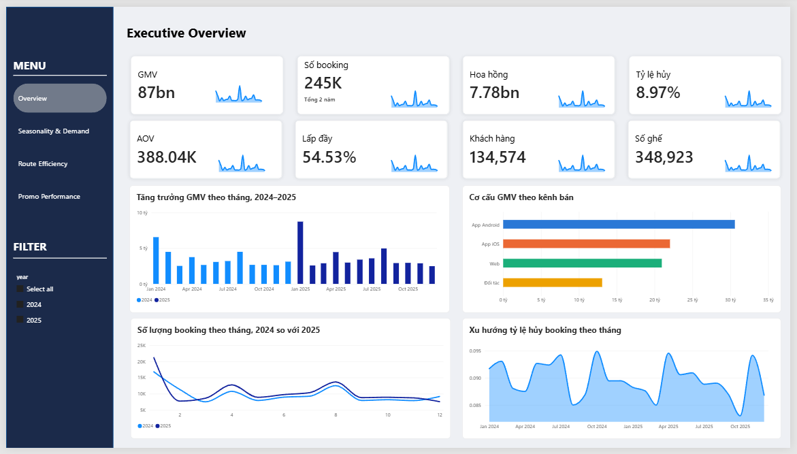
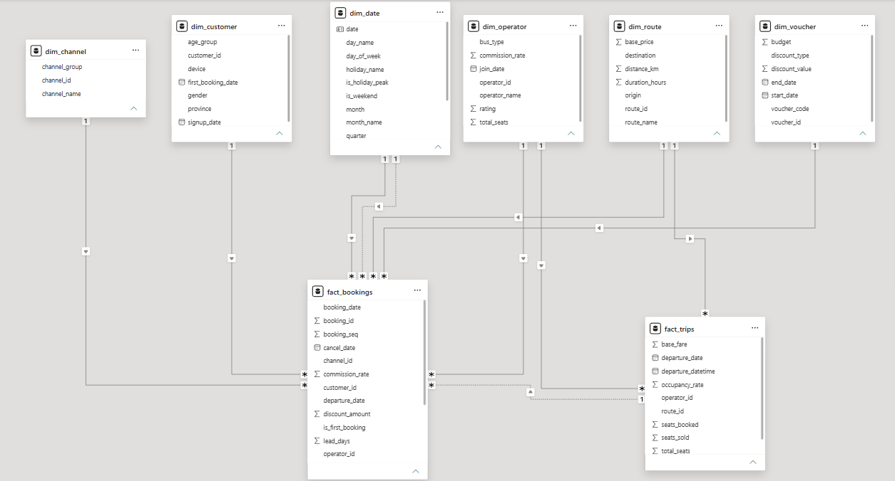
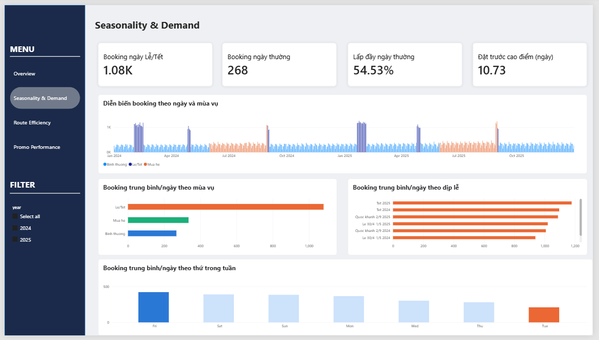
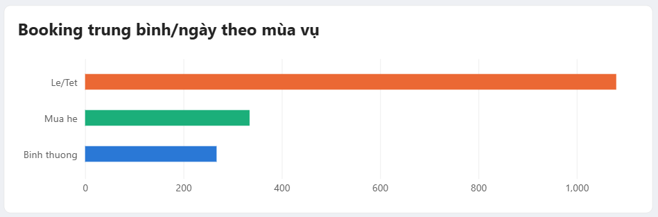
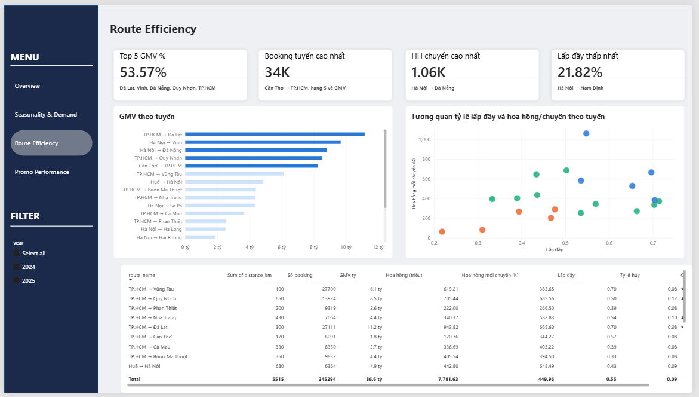
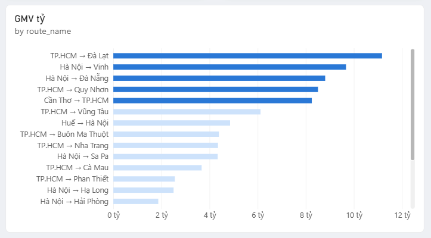
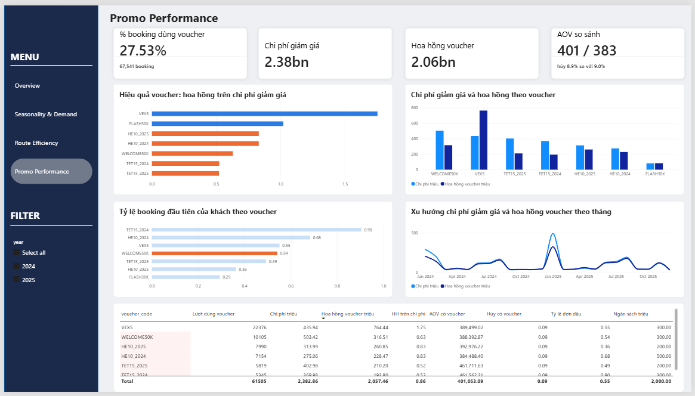

# Bus Ticket Analysis — Phân tích dashboard nền tảng đặt vé xe khách

> Dự án Business Intelligence trên **Power BI**: xây dựng mô hình dữ liệu Fact–Dimension cho một nền tảng đặt vé xe khách (marketplace) giả lập, thiết kế dashboard 4 trang và chuyển hóa dữ liệu thành **insight** và **khuyến nghị hành động** cho doanh nghiệp.

---

## 📌 Mục lục

1. [Tổng quan dự án](#1--tổng-quan-dự-án)
2. [Dữ liệu và mô hình dữ liệu](#2--dữ-liệu-và-mô-hình-dữ-liệu)
3. [Phân tích dashboard & insight](#3--phân-tích-dashboard--insight)
   - [Trang 1 – Executive Overview](#trang-1--executive-overview)
   - [Trang 2 – Seasonality & Demand](#trang-2--seasonality--demand)
   - [Trang 3 – Route Efficiency](#trang-3--route-efficiency)
   - [Trang 4 – Promo Performance](#trang-4--promo-performance)
4. [Insight tổng hợp](#4--insight-tổng-hợp)
5. [Khuyến nghị cho doanh nghiệp](#5--khuyến-nghị-cho-doanh-nghiệp)
6. [Lưu ý và giới hạn](#6--lưu-ý-và-giới-hạn)
7. [Công cụ sử dụng](#7--công-cụ-sử-dụng)

---

## 1. 🎯 Tổng quan dự án

**Bối cảnh (giả lập):** nền tảng kết nối hành khách với các nhà xe, cung cấp thông tin tuyến, lịch chạy, giá vé và ưu đãi. Khách đặt vé qua 4 kênh: **App Android, App iOS, Web, Đối tác**. Nền tảng thu **hoa hồng** theo thỏa thuận với nhà xe.

**Phương pháp trình bày:** *câu trả lời đi trước, bằng chứng đi sau* — mỗi trang dashboard bắt đầu từ một câu hỏi nghiệp vụ, sau đó đi theo chuỗi **Observation → Insight → Action**.

**Dashboard gồm 4 trang** (dùng chung bộ lọc năm 2024 / 2025):

| Trang | Câu hỏi nghiệp vụ | Đối tượng sử dụng |
|---|---|---|
| **Executive Overview** | Nền tảng đang ở quy mô nào, hiệu quả tài chính và vận hành ra sao? | Ban điều hành |
| **Seasonality & Demand** | Nhu cầu biến động thế nào theo mùa, ngày lễ, thứ trong tuần? | Vận hành, Pricing |
| **Route Efficiency** | Tuyến nào tạo giá trị, tuyến nào khai thác kém? | Vận hành, quản lý nhà xe |
| **Promo Performance** | Mỗi đồng giảm giá tạo ra bao nhiêu đồng hoa hồng? | Marketing, CRM |

---

## 2. Dữ liệu và mô hình dữ liệu

Giai đoạn **01/01/2024 – 31/12/2025**, tổ chức theo mô hình **Fact–Dimension** (galaxy schema): 2 bảng fact + 6 bảng dimension.

| Bảng | Loại | Quy mô | Grain |
|---|---|---|---|
| `fact_bookings` | Fact | 245.294 dòng | 1 dòng / booking |
| `fact_trips` | Fact | 17.294 dòng | 1 dòng / chuyến xe |
| `dim_customer` | Dimension | 134.574 dòng | 1 dòng / khách hàng |
| `dim_route` | Dimension | 20 dòng | 1 dòng / tuyến (có hướng) |
| `dim_operator` | Dimension | 30 dòng | 1 dòng / nhà xe |
| `dim_channel` | Dimension | 4 dòng | 1 dòng / kênh |
| `dim_voucher` | Dimension | 7 dòng | 1 dòng / voucher |
| `dim_date` | Dimension | 731 dòng | 1 dòng / ngày |

**Các điểm mô hình hóa đáng chú ý:**
- `dim_date` có **2 quan hệ** với `fact_bookings` (1 active, 1 inactive) cho hai vai trò thời gian: *ngày đặt* và *ngày khởi hành* → dùng `USERELATIONSHIP` khi cần đổi vai trò.
- Quan hệ `fact_bookings` ↔ `fact_trips` là **inactive** để tránh cộng chéo hai bảng fact; chỉ số cấp chuyến (ghế bán, lấp đầy) được tính đúng grain.
- `seats_booked` ≠ `seats_sold`: ghế bán chỉ tính booking `Completed`; `occupancy_rate = seats_sold / total_seats`.
- Kiểm tra chất lượng: không trùng khóa chính (`booking_id`, `trip_id`, `customer_id`), không có khóa ngoại mồ côi.

**Kiểm tra nhất quán số liệu giữa các trang:** tổng booking, GMV, hoa hồng, số khách hàng và % booking dùng voucher đều **khớp** giữa các trang; hai chênh lệch nhỏ (GMV/AOV, lượt dùng voucher) nhiều khả năng do cách đếm booking không hủy và được ghi chú định nghĩa trên dashboard.

---

## 3. Phân tích dashboard & insight

### Trang 1 – Executive Overview

> **Câu hỏi:** nền tảng đang vận hành ở quy mô nào, tạo ra bao nhiêu giá trị và khai thác nguồn cung hiệu quả đến đâu?

| Chỉ số | Kết quả | Nhận định |
|---|---|---|
| **GMV** | 87 tỷ | Trung bình ~3,6 tỷ/tháng |
| **Số booking** | 245.294 | ~336 booking/ngày |
| **Hoa hồng** | 7,78 tỷ | ~8,9% GMV — nguồn thu chính |
| **Tỷ lệ hủy** | 8,97% | ~22 nghìn booking (≈ 8,5 tỷ GMV nếu tính theo AOV) |
| **AOV** | 388,04K | Giá trị trung bình mỗi booking |
| **Lấp đầy** | 54,53% | Gần 46% ghế chưa được bán |
| **Khách hàng** | 134.574 | ~1,82 booking/khách |
| **Số ghế** | 348.923 | ~1,42 ghế/booking |

**Insight chính**

- **Tăng trưởng thực chất thấp hơn vẻ ngoài.** GMV tháng 01/2025 cao hơn 01/2024 ~35%, nhưng do Tết 2025 rơi vào 29/01 còn Tết 2024 rơi vào 10/02. Gộp tháng 01–02, GMV hai năm gần tương đương (~11,0 tỷ vs ~11,4 tỷ); booking cũng ngang nhau (28.928 vs 28.129).
- **Hai app di động là kênh chủ lực (~60% GMV):** Android ~35%, iOS ~25%, Web ~24%, Đối tác ~15%.
- **Nhu cầu có 3 cụm cao điểm lặp lại** (Tết, 30/4–1/5, hè & Quốc khánh 2/9); tháng cao nhất gấp ~2,6 lần tháng thấp nhất.
- **Tỷ lệ hủy ổn định** (~8,3–9,5%), không có xu hướng theo mùa → hủy mang tính **cấu trúc**, khác biệt đáng kể nằm ở chiều **tuyến** chứ không phải thời gian.

**Kết luận trang:** quy mô giao dịch và nguồn thu hoa hồng ổn định, nhưng còn **hai điểm rò rỉ giá trị: ghế trống và booking hủy**.

---

### Trang 2 – Seasonality & Demand

> **Câu hỏi:** nhu cầu biến động thế nào theo mùa, ngày lễ, thứ trong tuần và cần chuẩn bị nguồn cung vào thời điểm nào?

| Chỉ số | Kết quả |
|---|---|
| Booking trung bình/ngày Lễ/Tết | ~1,08K (**~4 lần** ngày thường) |
| Booking trung bình/ngày thường | 268 |
| Thời gian đặt trước giai đoạn cao điểm | 10,73 ngày |

**Insight chính**

- **Nhu cầu là các "xung nhọn" theo lịch:** mức nền ~250–300 booking/ngày; sáu cụm đột biến ~1K+/ngày (Tết, 30/4–1/5, 2/9 mỗi năm). Hình dạng hai năm gần trùng nhau → **dự báo theo lịch là khả thi**.
- Ngày Lễ/Tết chiếm ~7% số ngày nhưng tạo ra ~22% tổng booking (ước tính thô).
- **Hai loại "mùa cao điểm" cần hai chiến lược khác nhau:** Lễ/Tết ~1.080 booking/ngày (gấp ~4 lần), trong khi mùa hè chỉ ~330 (cao hơn ngày thường ~1,2 lần).
- Các dịp lễ lớn năm 2025 cao hơn 2024 ~8% (Tết 2025 ~1.175/ngày; 2/9/2025 ~1.085/ngày) → **rủi ro thiếu cung ở cao điểm tăng dần**.
- **Chu kỳ tuần rõ rệt:** Thứ Sáu – Thứ Hai cao (~360–410), Thứ Ba – Thứ Năm thấp; Thứ Ba chỉ bằng ~một nửa Thứ Sáu.

<table>
<tr>
<td> Booking/ngày theo ngày lễ</td>
</tr>
</table>

**Hàm ý hành động:** ưu tiên thương lượng nguồn cung và kiểm soát chất lượng cho **Tết → Quốc khánh → 30/4–1/5**; chốt kế hoạch cung trước 4–6 tuần cho tháng 01, 04, 08.

---

### Trang 3 – Route Efficiency

> **Câu hỏi:** tuyến nào tạo giá trị lớn nhất, tuyến nào khai thác kém hiệu quả, nên ưu tiên nguồn lực ở đâu?

| Chỉ số | Kết quả | Nhận định |
|---|---|---|
| **Top 5 GMV %** | 53,57% | 5 tuyến (25% số tuyến) tạo hơn một nửa GMV → **rủi ro tập trung** |
| **Booking tuyến cao nhất** | 34K (Cần Thơ → TP.HCM) | ~13,9% booking nhưng chỉ xếp hạng 5 về GMV (~241K/booking, thấp hơn AOV 388K) |
| **Hoa hồng/chuyến cao nhất** | 1,06K (Hà Nội → Đà Nẵng) | Gấp ~2,4 lần trung bình toàn mạng (449,96K) |
| **Lấp đầy thấp nhất** | 21,82% (Hà Nội → Nam Định) | Chỉ bằng ~0,4 lần mức trung bình |

**Insight chính**

- **Cấu trúc Pareto:** TP.HCM → Đà Lạt (~11,2 tỷ), Hà Nội → Vinh (~9,7), Hà Nội → Đà Nẵng (~8,8), TP.HCM → Quy Nhơn (~8,5), Cần Thơ → TP.HCM (~8,2). Mạng lưới xoay quanh hai đầu mối **TP.HCM và Hà Nội**.
- **Bất đối xứng theo chiều:** Cần Thơ → TP.HCM ~34K booking, ngược lại chỉ ~6,1K (≈ 5,6 lần) → chiều ít khách dễ chạy rỗng.
- **Lấp đầy cao ≠ sinh lời cao:** TP.HCM → Vũng Tàu lấp đầy ~0,70 nhưng hoa hồng/chuyến chỉ ~384K; Hà Nội → Đà Nẵng lấp đầy ~0,55 nhưng hoa hồng/chuyến cao nhất.
- **Tuyến dài hủy nhiều hơn:** Quy Nhơn (650 km) ~12%, Nha Trang (430 km) ~10%, so với ~8% ở nhóm 300–350 km.
- **Buôn Ma Thuột:** ~9,8K booking nhưng lấp đầy chỉ 0,33 → nhu cầu có sẵn, nguồn cung dư → **điều chỉnh số chuyến thay vì kích cầu**.

<table>
<tr>
<td> GMV theo tuyến</td>
</tr>
</table>

**Phân nhóm tuyến theo hành động**

| Nhóm | Tuyến tiêu biểu (lấp đầy; hoa hồng/chuyến) | Hướng xử lý |
|---|---|---|
| **Ngôi sao** | TP.HCM → Đà Lạt (0,70; ~666K); Hà Nội → Đà Nẵng | Bảo vệ nguồn cung, tối ưu giá cao điểm |
| **Khối lượng cao, giá trị thấp** | TP.HCM → Vũng Tàu (0,70; ~384K; 27,7K booking) | Nâng giá trị mỗi booking (hạng ghế, combo khứ hồi) |
| **Tiềm năng chưa khai thác** | TP.HCM → Quy Nhơn (0,50; ~686K); Huế → Hà Nội (0,43; ~645K) | Thúc đẩy lấp đầy bằng ưu đãi nhẹ có điều kiện; xử lý hủy ở Quy Nhơn |
| **Cần rà soát** | TP.HCM → Phan Thiết (0,39); Cà Mau (0,39); Buôn Ma Thuột (0,33); Hà Nội → Nam Định (0,22) | Giảm tần suất, ghép chuyến hoặc đàm phán lại với nhà xe |

**Kết luận trang:** *quy mô không đồng nghĩa với hiệu quả.* Bảo vệ nhóm Top 5; dư địa cải thiện nằm ở nhóm "tiềm năng chưa khai thác" và "cần rà soát".

---

### Trang 4 – Promo Performance

> **Câu hỏi:** mỗi đồng giảm giá tạo ra bao nhiêu đồng hoa hồng, voucher nào hiệu quả, và voucher có thu hút khách mới hay làm tăng giá trị đơn không?

| Chỉ số | Kết quả | Nhận định |
|---|---|---|
| **% booking dùng voucher** | 27,53% (67.541) | Khuyến mãi là phần lớn hoạt động bán hàng, không phải ngoại lệ |
| **Chi phí giảm giá** | 2,38 tỷ | ~2,7% GMV và ~30,6% tổng hoa hồng |
| **Hoa hồng voucher** | 2,06 tỷ | Thấp hơn chi phí giảm giá |
| **AOV có voucher vs không** | 401K vs 383K | Chênh lệch chủ yếu do hiệu ứng cơ cấu (TET15 ~462K); tỷ lệ hủy gần như không đổi (8,9% vs 9,0%) |

> **Hoa hồng / chi phí = 0,86** — mỗi 1 đồng giảm giá chỉ thu lại ~0,86 đồng hoa hồng, **thâm hụt ~325 triệu đồng**. Đây là hoa hồng của *toàn bộ* booking dùng voucher, không phải phần tăng thêm nhờ voucher → hiệu quả thực có thể còn thấp hơn.

**Kết quả theo voucher (triệu đồng)**

| Voucher | Chi phí | Hoa hồng | Chênh lệch | HH / chi phí |
|---|---:|---:|---:|---:|
| **VEX5** | 435,94 | 764,44 | **+328,5** | **1,75** |
| FLASH30K* | ~81,5 | ~83,2 | +1,7 | ~1,02 |
| HE10_2024 | 275,06 | 228,47 | −46,6 | 0,83 |
| HE10_2025 | 313,99 | 260,85 | −53,1 | 0,83 |
| TET15_2024 | 369,98 | 193,80 | −176,2 | 0,52 |
| WELCOME50K | 503,42 | 316,51 | −186,9 | 0,63 |
| TET15_2025 | 402,98 | 210,20 | −192,8 | 0,52 |
| **Tổng** | **2.382,86** | **2.057,46** | **−325,4** | **0,86** |

* FLASH30K được suy ra từ dòng Total trừ sáu mã còn lại (không hiển thị đầy đủ trên dashboard); cần lấy số chính xác từ Power BI.

**Insight chính**

- **Hiệu quả do thiết kế mức giảm quyết định, không phải năm hay thời điểm.** Hoa hồng mỗi lượt chỉ ~31–36K (~8–9% giá vé); VEX5 giảm ~5% → có lãi, HE10 ~10% và TET15 ~15% → lỗ. **Mức giảm vượt ~8–9% giá vé gần như chắc chắn đưa chỉ số xuống dưới 1.**
- **TET15 và WELCOME50K** chiếm ~53,6% chi phí nhưng chỉ tạo ~35,0% hoa hồng (chênh lệch ~−556 triệu). VEX5 bù được khoảng một nửa thâm hụt của năm mã còn lại.
- 🧑‍🤝‍🧑 **Chưa chứng minh được vai trò thu hút khách mới:** tỷ lệ đơn đầu của WELCOME50K (~0,54) và VEX5 (~0,55) xấp xỉ mốc nền (~54,9%). Với WELCOME50K, ~46% lượt dùng đến từ khách đã có booking trước đó (~232 triệu đồng chi phí).
- **Chi sai thời điểm:** chi phí dồn vào tháng 01 (~490 triệu năm 2025, ~20,6% chi phí hai năm) — đúng lúc nhu cầu đã gấp ~4 lần ngày thường. Hoa hồng/chi phí giảm từ ~0,79 (01/2024) xuống ~0,65 (01/2025) trong khi chi phí tăng ~69% còn nhu cầu cao điểm chỉ tăng ~8%. Ngược lại, các tháng thấp điểm (03, 05, 10–12) gần như không có ưu đãi, đúng lúc ghế trống nhiều nhất.
- **Chưa có cơ chế khóa trần chi phí:** tổng chi phí 2.382,86 triệu vượt ngân sách 2.000 triệu (~19%).

**Kết luận trang:** khuyến mãi đang được chi **sai thời điểm và sai mức**; dashboard chưa đo được hiệu quả *tăng thêm* (incremental) → cần nhóm đối chứng hoặc thử nghiệm A/B.

---

## 4. Insight tổng hợp

Giá trị lớn nhất của dashboard nằm ở việc **đọc chéo giữa các trang**:

| # | Phát hiện ở các trang | Kết luận tổng hợp |
|---|---|---|
| 1 | Lễ/Tết ~4 lần ngày thường (Trang 2) + chi phí voucher dồn vào tháng 01, HH/chi phí giảm 0,79 → 0,65 (Trang 4) | **Chi khuyến mãi nhiều nhất đúng lúc nhu cầu đã đầy** → chủ yếu trợ giá cho khách vốn sẽ mua |
| 2 | Lấp đầy 54,53% (Trang 1); Buôn Ma Thuột 0,33, Nam Định 0,22 (Trang 3); Thứ Ba ~210 booking, tháng 03/05/10–12 ở mức nền (Trang 2) | **Ghế trống tập trung ở tuyến, ngày và tháng cụ thể** — nơi ưu đãi có giá trị cận biên cao nhất nhưng hiện gần như chưa được dùng |
| 3 | Hủy ổn định ~9% (Trang 1); Quy Nhơn ~12%, Nha Trang ~10% (Trang 3) | Hủy mang tính cấu trúc, khác nhau theo tuyến → cần **chính sách theo tuyến** |
| 4 | WELCOME50K/VEX5 đơn đầu ~0,54–0,55 ≈ mốc nền ~54,9%; ~1,82 booking/khách | Voucher chưa chứng minh thu hút khách mới; tăng trưởng chủ yếu từ **khách cũ quay lại** |
| 5 | 5/20 tuyến chiếm ~53,6% GMV (Trang 3); Android ~35% GMV (Trang 1) | **Rủi ro tập trung ở cả tuyến và kênh** |
| 6 | Hà Nội → Đà Nẵng, Quy Nhơn: hoa hồng/chuyến cao nhưng lấp đầy ~0,50–0,55 (Trang 3); voucher giảm sâu không bù chi phí (Trang 4) | Nên **lấp ghế bằng ưu đãi nhẹ, có điều kiện, trên tuyến giá cao** thay vì giảm sâu trên tuyến bất kỳ |

> **Tóm lại:** nền tảng có quy mô tốt và nhu cầu mùa vụ rõ rệt, nhưng tăng trưởng thực chất giữa hai năm khiêm tốn, gần một nửa ghế còn trống, ~9% booking bị hủy và công cụ khuyến mãi đang được dùng *ngược logic*: chi mạnh ở cao điểm, bỏ trống ở thấp điểm, mức giảm sâu hơn tỷ lệ hoa hồng. **Cơ hội lớn nhất không nằm ở mở rộng cung, mà ở sử dụng tốt hơn nguồn cung hiện có và chi tiêu khuyến mãi đúng chỗ.**

---

## 5. Khuyến nghị cho doanh nghiệp

### 5.1. Bảng khuyến nghị ưu tiên

| Ưu tiên | Khuyến nghị | KPI theo dõi | Tác động ước tính |
|---|---|---|---|
| **1 – Cao** | **Tái cấu trúc voucher:** mức giảm ≤ ~8–9% giá vé; dừng hoặc thay TET15; WELCOME50K chỉ cho đơn đầu của tài khoản mới, có ngưỡng đơn tối thiểu; mở rộng thử nghiệm VEX5; đặt trần chi phí cho từng mã | HH/chi phí ≥ 1,0 (từ 0,86); chi phí ≤ ngân sách; tỷ lệ đơn đầu của WELCOME50K ≥ 80% | Dừng TET15 tiết kiệm ~773 triệu chi phí, mất tối đa ~404 triệu hoa hồng → cải thiện hoa hồng ròng ≥ ~369 triệu ở mọi mức "tăng thêm" từ 0–100% (chưa tính giá trị vòng đời) |
| **1 – Cao** | **Chuyển khuyến mãi sang điểm trũng:** Buôn Ma Thuột, Phan Thiết, Cà Mau, Hà Nội → Nam Định; Thứ Ba – Thứ Năm; tháng 03, 05, 10–12; voucher lấp ghế có điều kiện chuyến hoặc khung giờ | Lấp đầy tuyến mục tiêu và giữa tuần; HH/chi phí của voucher lấp ghế | +1 điểm % lấp đầy ≈ +1,8% ghế bán ≈ ~1,6 tỷ GMV và ~143 triệu hoa hồng trong 2 năm (ước tính tuyến tính) |
| **2 – Cao** | **Lịch cao điểm và giá động:** hệ số nhu cầu theo từng dịp, giá cao ở đỉnh, ưu đãi đặt sớm ngoài đỉnh; thương lượng thêm chuyến trước Tết 4–6 tuần | Doanh thu/ghế cao điểm; tỷ lệ chuyến kín; thời gian đặt trước | Giữ giá trị khi nhu cầu gấp ~4 lần mức nền |
| **2 – Trung bình** | **Giảm hủy theo tuyến:** phí hủy theo bậc thời gian, nhắc lịch trước ngày đi, cho đổi chuyến thay vì hủy; ưu tiên Quy Nhơn và Nha Trang | Tỷ lệ hủy từ 8,97% xuống ≤ ~8%; hủy theo tuyến | −1 điểm % hủy ≈ ~2,45 nghìn booking, ~0,95 tỷ GMV và ~85 triệu hoa hồng trong 2 năm (nếu giữ lại hoặc bán lại được) |
| **3 – Trung bình** | **Quản lý danh mục tuyến theo 4 nhóm** (Ngôi sao / Khối lượng cao–giá trị thấp / Tiềm năng / Cần rà soát); combo khứ hồi cho Vũng Tàu và Cần Thơ → TP.HCM; rà soát tuyến lấp đầy dưới ~40% | Hoa hồng/chuyến và lấp đầy theo nhóm tuyến | Tái phân bổ chuyến sang tuyến tiềm năng |
| **3 – Trung bình** | **Tối ưu kênh bán:** đầu tư trải nghiệm app Android/iOS (~60% GMV), duy trì Web, đánh giá chi phí phân phối của kênh Đối tác | AOV, tỷ lệ hủy, hoa hồng theo kênh | Giảm phụ thuộc vào một kênh (Android ~35%) |

### 5.2. Lộ trình triển khai đề xuất

| Giai đoạn | Việc cần làm |
|---|---|
| **0–30 ngày** | Chốt định nghĩa chỉ số; sửa các lỗi hiển thị dashboard; đặt trần chi phí cho từng voucher |
| **30–90 ngày** | Thiết kế lại bộ voucher theo quy tắc mức giảm ≤ ~8–9%; chạy A/B cho VEX5 và voucher lấp ghế giữa tuần; dựng lịch cao điểm |
| **90–180 ngày** | Áp dụng giá động và ưu đãi đặt sớm cho cao điểm; chính sách hủy theo bậc; rà soát lịch chạy các tuyến lấp đầy thấp |

---

## 6. Lưu ý và giới hạn

- Toàn bộ số liệu dựa trên **dữ liệu mô phỏng** — giá trị của dự án nằm ở cách đặt câu hỏi, kiểm tra chéo số liệu, diễn giải và chuyển hóa insight thành hành động, **không** nhằm kết luận về thị trường thực tế.
- Dataset chưa có chi phí theo kênh, nhật ký chuyển trạng thái, giao dịch thanh toán/hoàn tiền thực tế hay hợp đồng hoa hồng.
- `budget` của voucher là giá trị gán trong dữ liệu mô phỏng; các nhận định về vượt ngân sách mang tính minh họa quản trị.
- Một số con số được **suy ra/ước tính thô** từ dashboard (đã ghi rõ trong phần phân tích), ví dụ FLASH30K, tỷ lệ đơn đầu mốc nền.
- Hoa hồng của booking dùng voucher **không phải** phần tăng thêm nhờ voucher; để đo hiệu quả incremental cần nhóm đối chứng hoặc A/B test.
- Một số đề xuất cải thiện dashboard: ghi rõ tên tuyến có hướng trên thẻ KPI, bổ sung chú giải/nhãn tuyến cho biểu đồ phân tán, đổi nhãn "Booking ngày…" thành "Booking trung bình/ngày…", ghi chú định nghĩa mẫu số trên từng chỉ số.

---

## 7. Công cụ sử dụng

- **Power BI** — mô hình dữ liệu, DAX measures, thiết kế dashboard
- **Mô hình Fact–Dimension (Kimball)** — star/galaxy schema
- Phương pháp trình bày: *Pyramid Principle* (Minto) và *Storytelling with Data* (Knaflic)

---

## Tài liệu tham khảo

- Kimball, R., & Ross, M. (2013). *The Data Warehouse Toolkit: The Definitive Guide to Dimensional Modeling* (3rd ed.). Wiley.
- Microsoft Learn. *Understand star schema and the importance for Power BI.*
- Minto, B. (2009). *The Pyramid Principle: Logic in Writing and Thinking.* Pearson Education.
- Knaflic, C. N. (2015). *Storytelling with Data: A Data Visualization Guide for Business Professionals.* Wiley.
